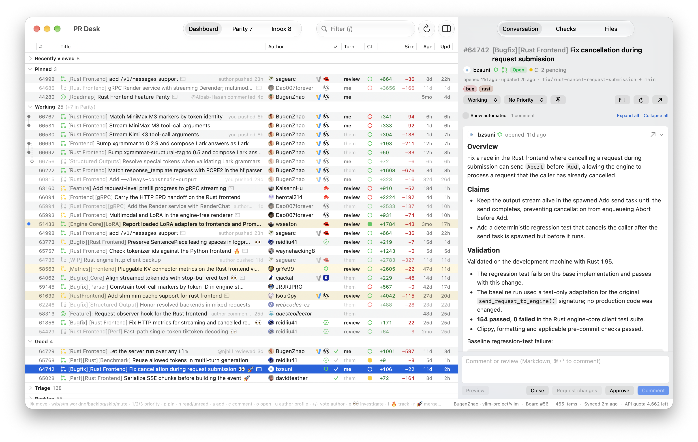

# PR Desk

A native macOS dashboard for the pull requests and issues I work on in
[vllm-project/vllm](https://github.com/vllm-project/vllm).



> [!NOTE]
> This is a personal app, built around my own workflow. It's hard-wired to `vllm-project/vllm`,
> to my triage board (GitHub Project #56), and to a few other tools I use. It isn't meant to be used
> by anyone else as-is, and I don't support it. The source is here for reference.

## What it does

- One dense, keyboard-driven list of the PRs and issues I'm involved in, grouped by their status
  on the triage board, with whose turn it is, CI, diff size and age at a glance
- A detail pane with the conversation, checks and files diff, where I can comment, review and approve
- An inbox of GitHub notifications for the repository
- Badges for contributors' affiliations, and stacked PRs drawn as trees
- Sending items to Grok Bots, and mirroring pinned items into Yab's sidebar

[`SPEC.md`](SPEC.md) is the full spec, and [`AGENTS.md`](AGENTS.md) holds notes for
coding agents.

## Building

Needs macOS 26, Xcode 26, [Tuist](https://tuist.dev), a Rust toolchain (for the bundled grokbot
CLI), and either `gh auth login` or a personal access token in Settings.

```sh
tuist generate --no-open
xcodebuild -workspace PRDesk.xcworkspace -scheme PRDesk -derivedDataPath .build/DerivedData build
open .build/DerivedData/Build/Products/Debug/PRDesk.app
```

`scripts/install.sh` builds a Release copy and installs it to `/Applications`.

## Third-party

- [GRDB.swift](https://github.com/groue/GRDB.swift) (MIT)
- [highlight.js](https://highlightjs.org) (BSD-3-Clause, `PRDesk/Web/highlight.LICENSE`)
- [Octicons](https://primer.style/octicons) for the PR state icons (MIT, `PRDesk/octicons.LICENSE`)
- [Lobe Icons](https://github.com/lobehub/lobe-icons) for the Cohere and Tencent badges (MIT, `PRDesk/lobe-icons.LICENSE`)
